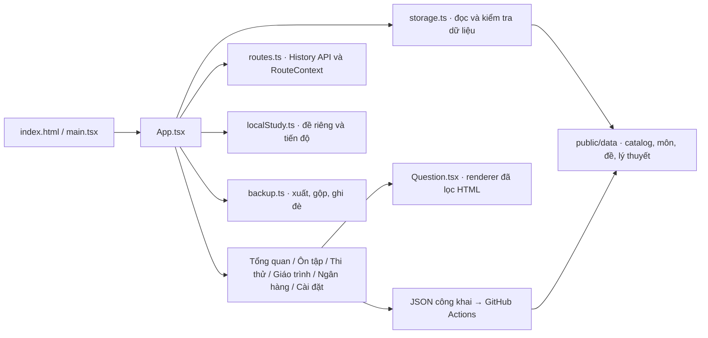

# Review dự án BPMS — Business Process Management System

**Phạm vi** · Workspace BPS301 ngày 22/11/2026, gồm bản đổi thương hiệu BPMS đang chỉnh cục bộ. Tài liệu mô tả mã nguồn thực tế, kết quả kiểm tra và các điểm cần xử lý trước khi mở rộng.

## 1. Tổng quan và kiến trúc

BPMS là ứng dụng tự ôn và thi thử môn **BPS301 — Business Process Management & Process Mining**. React 19 và TypeScript strict chạy trên trình duyệt, Vite 7 build thành tệp tĩnh cho GitHub Pages. CSS tự viết và Lucide đảm nhiệm giao diện. DOMPurify làm sạch HTML trước khi hiển thị. Người học sử dụng ứng dụng mà không cần tài khoản hay backend. Quyền ghi repo chỉ cần cho quản trị viên công khai đề qua GitHub Actions.



- [index.html](index.html) đặt tiêu đề, favicon, font và tải [main.tsx](src/main.tsx), nơi React gắn vào phần tử `#root`.
- [App.tsx](src/App.tsx) điều phối state, nạp môn, điều hướng, lưu dữ liệu và xử lý phiên thi hết hạn. Màn hình nhận dữ liệu và callback. `dataRef` giữ snapshot mà callbacks và bộ hẹn giờ sử dụng. Thao tác ghi đi qua `persist()` để báo lỗi tập trung.
- [routes.ts](src/routes.ts) dùng History API và React Context để chuẩn hóa path, tách query/hash và giải quyết bí danh đề/câu. Không có thư viện router riêng trong dependencies.
- [styles.css](src/styles.css) chứa sidebar desktop, menu mobile, CSS theo chế độ học, theme sáng/tối và cỡ chữ. Logo gốc ở [img/logo.jpg](img/logo.jpg), bản Vite phục vụ ở [public/img/logo.jpg](public/img/logo.jpg).
- [vite.config.ts](vite.config.ts) dùng base `/` cho dev và `/BPS301/` cho production/preview. Cấu hình [package.json](package.json) định nghĩa các lệnh dev, build, preview. CI cài bằng [package-lock.json](package-lock.json) trên Node 22.

## 2. Bản đồ mã nguồn

| Tệp | Vai trò |
| --- | --- |
| [src/data/model.ts](src/data/model.ts) | Kiểu Subject, Exam, Question, Session, Study, Save. Chấm theo tập ID, khử trùng câu theo ID và trộn Fisher–Yates. |
| [src/data/storage.ts](src/data/storage.ts) | Chuẩn hóa và kiểm tra JSON, tải danh mục, xác thực snapshot và đường dẫn tài nguyên, tạo JSON tải xuống. |
| [src/data/localStudy.ts](src/data/localStudy.ts) | Tách kho đề khỏi tiến độ, đọc lại snapshot, tương thích dữ liệu cũ và hoàn tác khi lần ghi thứ hai thất bại. |
| [src/data/backup.ts](src/data/backup.ts) | Xuất theo phạm vi, xem trước metadata, gộp/ghi đè và ước tính dung lượng origin. |
| [src/data/preferences.ts](src/data/preferences.ts) | Giá trị mặc định, xác thực tùy chọn và đọc theme cũ. |
| [src/components/Question.tsx](src/components/Question.tsx) | Renderer nội dung, tô từ khóa, radio/checkbox, trạng thái đáp án và khung giải thích. |
| [src/components/Progress.tsx](src/components/Progress.tsx) | Thanh tiến độ dùng thẻ HTML chuẩn, có nhãn hỗ trợ công nghệ trợ năng. |
| [src/features/Overview.tsx](src/features/Overview.tsx) | KPI, lộ trình, điều hướng tiếp tục học và hoạt động gần đây. |
| [src/features/LearningReport.tsx](src/features/LearningReport.tsx) | Thống kê theo chương, theo đề và lịch sử đầy đủ từ dữ liệu đã lưu. |
| [src/features/Practice.tsx](src/features/Practice.tsx) | Bộ lọc, tiến độ từng câu, chấm, đánh dấu khó, reset, phím tắt và tự chuyển câu. |
| [src/features/Exam.tsx](src/features/Exam.tsx) | Tạo/tiếp tục phiên, đồng hồ, ma trận câu, nộp bài, kết quả và chữa câu sai. |
| [src/features/Library.tsx](src/features/Library.tsx) | Lý thuyết, tìm kiếm, chương/anchor, tổng hợp công thức/lưu ý và trình xem tài liệu. |
| [src/features/Bank.tsx](src/features/Bank.tsx) | Tìm, lọc, chỉnh sửa, xem chi tiết, nhập nhiều tệp và xuất ngân hàng. |
| [src/features/ExamUpload.tsx](src/features/ExamUpload.tsx) | Tạo một đề riêng từ JSON, kiểm tra tức thì, prompt mẫu, danh sách đề và JSON công khai. |
| [src/features/Settings.tsx](src/features/Settings.tsx) | Sao lưu, xem trước khôi phục, dung lượng, reset phân cấp và tùy chọn học/hiển thị. |
| [scripts/publish-exam.mjs](scripts/publish-exam.mjs) | Dùng parser của app để xác thực đề công khai, chống trùng và cập nhật danh mục. |
| [scripts/extract-bps301.mjs](scripts/extract-bps301.mjs) | Trích dữ liệu từ prototype HTML cũ. Tệp đầu vào mà script yêu cầu vắng mặt trong checkout hiện tại. |

## 3. Dữ liệu chính thức và schema

[catalog.json](public/data/catalog.json) trỏ đến [subject.json](public/data/bps301/subject.json). Cấu hình môn liệt kê [lý thuyết](public/data/bps301/theory.json), tệp đề, chủ đề và giáo trình. Thành phần app hiện chọn môn theo ID `bps301`.

| Tệp đề trong public/data/bps301/exams/ | Tên trong ứng dụng | Số câu |
| --- | --- | ---: |
| FA26.json | FA25 | 59 |
| SU26.json | Đề 2 · SU26 FE | 48 |
| FE_Mock.json | FE Mock | 3 |
| BPS301_FA26_FE_805603.json | BPS301 — FA26 FINAL EXAM 805603 | 50 |
| bonus_100c.json | Ngân hàng 100 câu hỏi ôn tập | 100 |

Tổng hiện có **260 câu, gồm 6 câu nhiều đáp án, và 11 chương lý thuyết**. Danh mục chủ đề và tài liệu mặc định đang rỗng. Có 150 câu chưa có trường chương, 2 câu ghi chương 12, và chương 10 chỉ có một câu được gắn chương.

### Định dạng và ID

- **Chuẩn v1** gồm `version: 1`, `subjectId` và mảng `exams`. Mỗi câu có ID, loại single/multiple, nội dung, danh sách lựa chọn có ID và mảng ID đáp án. Metadata có thể gồm code, chương, chủ đề, giải thích, mẹo, công thức và liên kết trang tài liệu.
- **Định dạng đề gốc** dùng `exam_title`, `questions`, loại SINGLECHOICE/MULTIPLECHOICE, lựa chọn dạng object và `answer` hoặc `answers_list`. Form Upload cho phép ưu tiên tên/mã nhập trên web, ghép mã đề với ID câu và so khớp khi cả hai trường đáp án cùng xuất hiện.
- **Định dạng cũ** dùng trường `exam`, `question` và mảng chuỗi lựa chọn có tiền tố. Adapter này có ở luồng nhập Ngân hàng. JSON từ **Xuất ngân hàng** là ví dụ đầy đủ cho chuẩn v1.

```json
{
  "version": 1,
  "subjectId": "bps301",
  "exams": [{
    "id": "BPS301_EXAMPLE",
    "title": "Ví dụ cấu trúc đề",
    "questions": [{
      "id": "BPS301_EXAMPLE_1",
      "chapterId": "2",
      "type": "single",
      "prompt": "Which notation is used for process modeling?",
      "options": [
        { "id": "A", "content": "BPMN" },
        { "id": "B", "content": "SQL" }
      ],
      "answers": ["A"]
    }]
  }]
}
```

### Luồng nạp và hợp nhất

1. App đọc snapshot cục bộ, xác thực kiểu dữ liệu và khôi phục tùy chọn.
2. `loadSubjects()` đọc catalog, cấu hình môn, lý thuyết và các tệp đề. Tệp đề đọc lỗi có thể được báo riêng để các đề hợp lệ vẫn tải. Lỗi cấu hình, lỗi giáo trình hoặc trùng ID giữa các đề vẫn có thể chặn việc nạp môn.
3. App ghép bộ đề chính thức và bộ đề riêng theo ID, ghép câu theo ID rồi áp dụng các bản chỉnh sửa. Bản chính thức cùng mã được ưu tiên tiêu đề.
4. Tổng quan, Ôn tập, Thi thử và Ngân hàng nhận cùng danh sách đã ghép. Giữ ID ổn định khi sửa nội dung để kết quả, dấu câu khó và URL còn đối chiếu được.

## 4. Định tuyến và nghiệp vụ

Các path sau dùng tiền tố `/BPS301` trên Pages.

| Route | Hành vi |
| --- | --- |
| /, /home | Chuẩn hóa sang Tổng quan. |
| /home/analytics, /home/history | Thống kê đúng sai và lịch sử học. |
| /trainning/exam/fa26_fe, /trainning/chapter/6?q=3 | Ôn theo đề, chương hoặc vị trí câu. /training là bí danh tương thích. |
| /trainning/question/:id, /trainning/review/wrong, /trainning/review/bookmarked | Mở câu trực tiếp hoặc hàng đợi cá nhân. |
| /mock_exam/:slug, /mock_exam/:slug/q/:number | Chọn đề và vào phiên đang làm. Query session chỉ định phiên. |
| /mock_exam/:slug/result?filter=wrong | Kết quả đã nộp và lọc câu sai. |
| /curriculum/chapter/:id#anchor, /curriculum?search=… | Mở chương/mục và tìm trong giáo trình. |
| /curriculum/formulas, /curriculum/pitfalls | Trích công thức và điểm dễ nhầm từ giáo trình. |
| /question_bank/detail/:id, /question_bank?chapter=5&status=wrong | Xem chi tiết hoặc lọc câu. |
| /settings | Lưu trữ, tải đề, reset và cấu hình. |

**Ôn tập.** Câu chọn một chấm ngay khi chọn. Câu chọn nhiều lưu bản nháp và chấm khi bấm kiểm tra. Bookmark là trạng thái riêng. Tự chuyển câu chỉ áp dụng khi lần kiểm tra mới trả lời đúng. `Shift+B` đánh dấu khó, các phím `1–4` hoặc `A–D` chọn đáp án trong ngữ cảnh phù hợp.

Quy tắc chấm trong [model.ts](src/data/model.ts):

```ts
return selected.length === question.answers.length &&
  question.answers.every((id) => selected.includes(id))
```

**Thi thử.** Mỗi phiên giữ snapshot đề, thứ tự lựa chọn, bài làm, cờ và thời hạn tuyệt đối. F5 hoặc đóng tab vẫn tiêu thời gian. Khi mở lại, App tự nộp phiên quá hạn nếu phiên bật tự nộp. Khi tắt, phiên quá hạn khóa lựa chọn và cho nộp thủ công. Điểm thang 10, mỗi câu trọng số bằng nhau và câu bỏ trống tính sai. Các preset 50 câu/45 phút và 15 câu/15 phút ưu tiên rải mẫu qua nhóm chương 1–10 rồi bù từ số câu còn lại.

**Báo cáo.** Tỷ lệ đúng ở Tổng quan tính theo lượt kiểm tra ôn, số câu đã ôn tính theo ID, điểm trung bình tính theo bài thi đã nộp. Báo cáo phân tích kết hợp lượt ôn và câu trong bài thi đã nộp. URL chia sẻ được vị trí và bộ lọc. Phiên thi, câu sai và đáp án riêng đọc từ kho của trình duyệt đang mở.

**Giáo trình.** Nội dung HTML qua DOMPurify. Tìm kiếm tô từ khóa. Các trang tổng hợp trích nội dung theo cấu trúc và từ khóa trong giáo trình. PDF dùng trình xem của trình duyệt, PPTX cần PDF hoặc ảnh xem trước. Tệp tài liệu nhập qua UI giới hạn 1,5 MB mỗi tệp.

## 5. Lưu cục bộ, sao lưu và công khai

| Khóa lưu trữ | Nội dung |
| --- | --- |
| bps301_custom_exams_v1 | Bộ đề riêng theo môn |
| bps301_user_progress_v1 | Lượt ôn, chọn đáp án, câu khó, bản chỉnh sửa, tài liệu cục bộ, phiên thi và lịch sử |
| smart-exam-preferences-v1 | Tùy chọn học, thi và giao diện |
| smart-exam-v1, smart-exam-theme | Tương thích bản lưu cũ |

Các khóa thuộc origin và hồ sơ trình duyệt. Localhost và GitHub Pages có kho riêng. Dùng sao lưu để chuyển dữ liệu. Lượt chuyển đổi từ khóa cũ chỉ dọn khóa cũ sau khi ghi hai khóa mới thành công. UI hiển thị ước tính dung lượng origin với mốc tham chiếu 5 MB.

- **Xuất toàn bộ** gồm đề, tiến độ, tài liệu và tùy chọn. **Chỉ tiến độ** bỏ đề riêng, bản chỉnh sửa, tài liệu và tùy chọn.
- **Gộp** ưu tiên bản đang có khi trùng ID, hợp nhất lịch sử và ưu tiên bài đã nộp hơn phiên đang làm cùng ID. **Ghi đè theo phạm vi** giữ dữ liệu riêng khi tệp chỉ có tiến độ.
- **Đặt lại** có phạm vi lượt ôn/thi, bookmark hoặc khôi phục gốc qua hai lần xác nhận.
- **Công khai bộ đề** dùng JSON chuẩn từ nút sao chép và workflow [publish-exam.yml](.github/workflows/publish-exam.yml). Workflow xác thực đầu vào và catalog, tạo tệp mới và cập nhật manifest trong cùng commit, rồi gọi Pages build từ SHA mới. Tài khoản chạy cần quyền ghi repo. Với tệp lớn, có thể dùng quy trình thêm JSON và manifest qua commit/PR.
- Dữ liệu đề công khai và đáp án đọc được trong tệp tĩnh. Hệ thống phù hợp với tự luyện. Thi có yêu cầu giữ bí mật cần lớp xác thực và chấm điểm tại máy chủ.

## 6. Chạy, build và vận hành

```sh
npm ci
npm run dev
npm run build
npm run preview
```

Dùng Node.js 22.12+ theo README. Preview dùng `/BPS301/`. [pages.yml](.github/workflows/pages.yml) chạy trên push main, khi kích hoạt thủ công hoặc khi workflow công khai gọi lại. CI cài dependencies, chạy kiểm tra TypeScript và build Vite, đóng gói `dist/` rồi triển khai.

- Nếu Pages trắng và HTML công khai chứa `/src/main.tsx`, kiểm tra **Settings → Pages → Source**. Nguồn phù hợp với dự án là **GitHub Actions**, bản build trỏ tới script trong `/BPS301/assets/`.
- Khi mở URL sâu, [404.html](public/404.html) chuyển đến trang gốc cùng path/query/hash đã mã hóa. `index.html` phục hồi URL trước khi ứng dụng định tuyến. Nếu đổi repo hoặc base, cập nhật cùng lúc Vite, fallback và các liên kết liên quan.
- Khi tệp đề lỗi, đối chiếu đường dẫn được báo, mã câu, đáp án và ID trùng giữa các đề. Khi lưu lỗi quota, sao lưu trước khi dọn tài liệu hoặc lịch sử.

## 7. Phát hiện review và ưu tiên

| Ưu tiên | Phát hiện | Tác động và bước xử lý |
| --- | --- | --- |
| Cao | Mapping chương chưa đồng nhất, trong đó 150 câu chưa có chương, 2 câu mang chương 12. Tên FA25 đang nằm trong FA26.json. | Lọc, KPI chương và lấy mẫu phụ thuộc dữ liệu này. Đối chiếu giáo trình trước khi gán chương; khi đổi tên tệp, cập nhật manifest và giữ ID/bí danh. |
| Cao | Hàm ghi tiến độ và kho đề ghi hai khóa liên tiếp; callback lấy snapshot từ dataRef. | Có rủi ro snapshot lệch nếu trang dừng giữa hai ghi hoặc hai tab ghi sát nhau. Rollback xử lý thất bại trong lần gọi. Kiểm thử cạnh tranh và quota trước khi cân nhắc IndexedDB hoặc cơ chế khóa/phiên bản. |
| Cao nếu dùng để thi thật | Đáp án nằm trong JSON công khai, chấm điểm phía client. | Người dùng có thể đọc đáp án qua tệp dữ liệu. Nếu cần bảo mật đề, chuyển phát đề và chấm sang máy chủ với quyền truy cập. |
| Trung bình | Hai tệp hợp lệ riêng lẻ có thể trùng ID ở cấp môn. | Có thể chặn việc nạp môn. Thêm kiểm tra manifest và dữ liệu vào CI. |
| Trung bình | App.tsx kiêm điều hướng, deadline, lưu, tùy chọn và các vùng giao diện. | Việc thay đổi dễ ảnh hưởng luồng khác. Tách điều phối vòng đời phiên và lưu trữ sau khi có kiểm thử bảo vệ. |
| Trung bình | Tài liệu base64 và snapshot nhiều phiên có thể làm dung lượng tăng nhanh. | Kiểm thử ghi lỗi gần quota. Theo dõi riêng kích thước tệp, đề và lịch sử nếu dung lượng trở thành vấn đề. |
| Trung bình | Workflow công khai phụ thuộc quyền ghi main, branch protection, Pages Source và giới hạn đầu vào. | Xác nhận quy trình trên GitHub trước khi dùng với đề thật. Dùng commit/PR cho tệp quá lớn. |
| Thấp | Script extract đọc HTML cũ vắng mặt và có thể ghi trực tiếp vào danh mục hiện hành. | Xem là công cụ lịch sử. Nếu phục hồi đầu vào, chạy với đầu ra riêng rồi đối chiếu trước khi thay dữ liệu. |
| Thấp | Repo còn ảnh PNG thương hiệu cũ và khóa mang tên smart-exam. | PNG là tài nguyên dư trong luồng logo hiện tại. Khóa lưu trữ cần tương thích khi đổi tên để người học vẫn đọc được dữ liệu trước đó. |

## 8. Kiểm tra đã thực hiện và checklist phát hành

**Trong lượt review này:** đã đọc mã nguồn, đối chiếu manifest và dữ liệu, kiểm tra cấu hình GitHub Actions và chạy thành công `npm run build` bằng Node 24.16.0. Build dùng TypeScript và Vite 7.3.8. Chưa chạy lại toàn bộ QA trình duyệt hay chạy workflow công khai trên GitHub. Bộ chạy thử cục bộ nằm trong thư mục Git bỏ qua. `package.json` và CI chưa công bố lệnh kiểm thử hồi quy.

Checklist nên chạy trước khi phát hành:

1. Build với Node cùng phiên bản CI. Mở URL trực tiếp, F5, Back/Forward, query và anchor ở base production.
2. Kiểm tra ôn một/nhiều đáp án, nháp, câu khó, phím tắt, tự chuyển và reset phạm vi.
3. Kiểm tra thi có/không giới hạn, hết giờ ở cả hai chế độ tự nộp, giữ snapshot sau F5 và lọc câu sai sau nộp.
4. Kiểm tra Upload và Ngân hàng với JSON hợp lệ, sai schema, trùng ID, gỡ đề và hai hồ sơ trình duyệt khác nhau.
5. Kiểm tra sao lưu toàn bộ/chỉ tiến độ, dữ liệu cũ, gộp, ghi đè, tranh chấp giữa tab và trường hợp quota.
6. Kiểm tra giao diện desktop/mobile, logo/favicon, giáo trình và trạng thái workflow triển khai thực tế.

Ưu tiên tiếp quản là **chuẩn hóa chương và kiểm tra catalog**, sau đó **đưa kiểm thử parser, sao lưu và deadline vào CI**. Khi có kiểm thử bảo vệ, củng cố ghi dữ liệu nhiều tab và tách các luồng điều phối lớn khỏi App.
