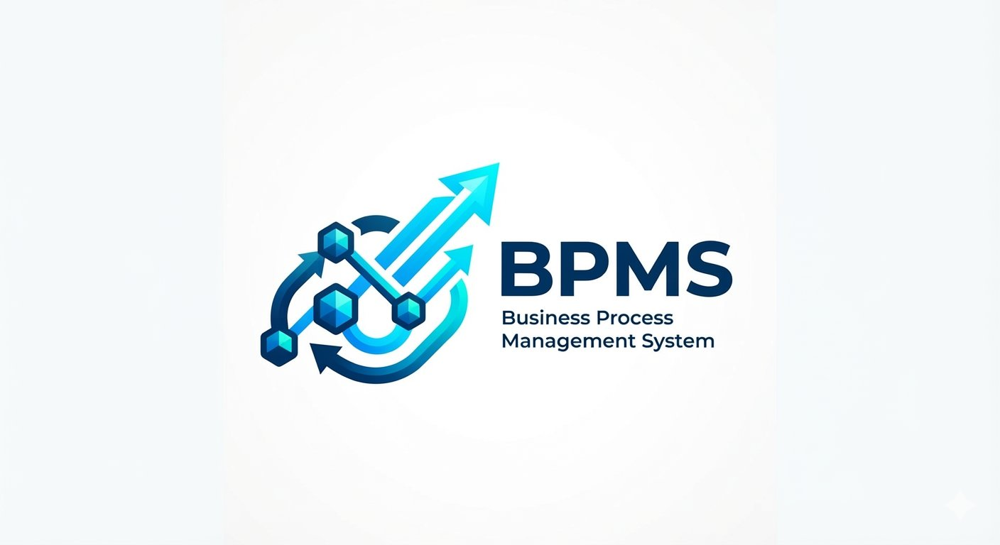
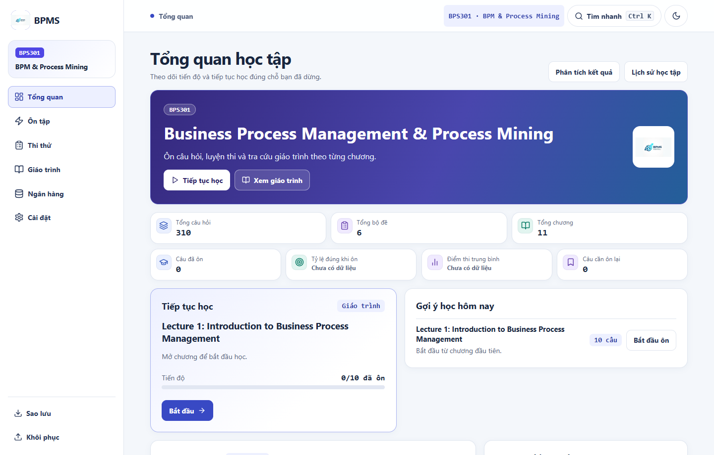
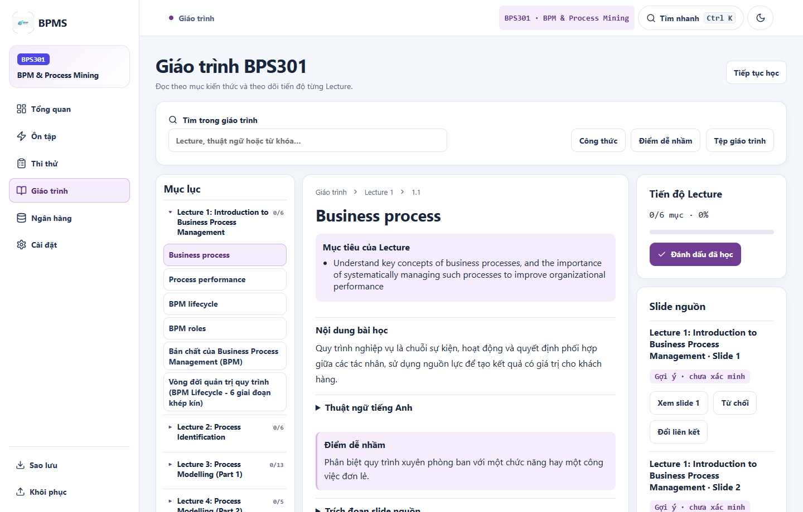
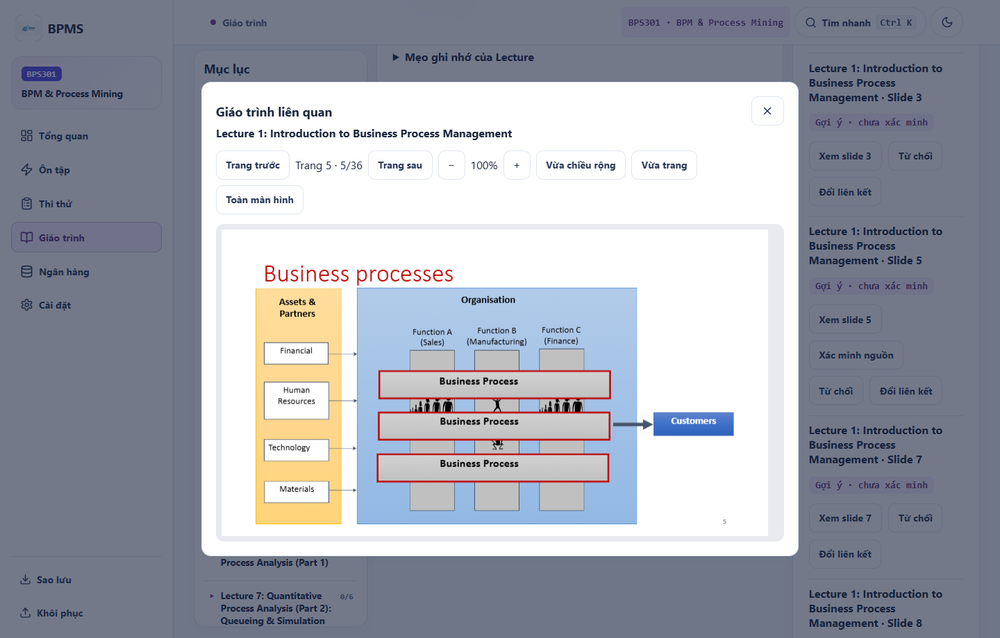
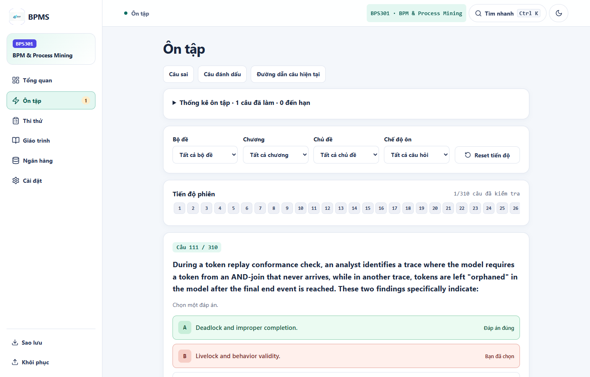
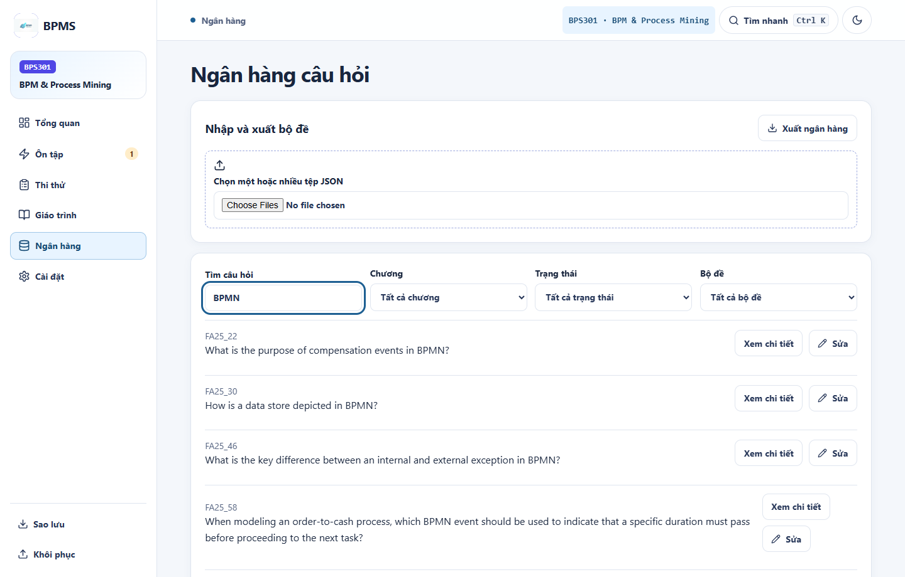
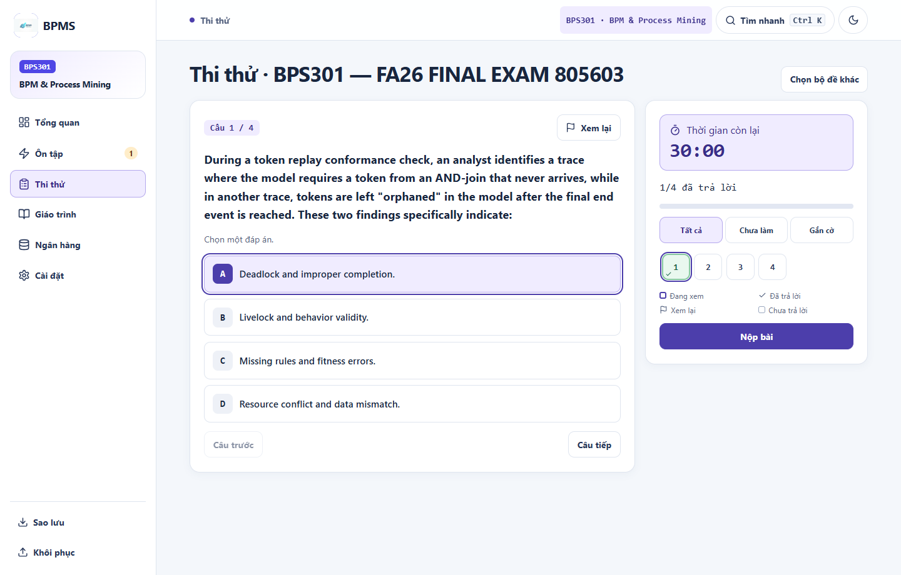
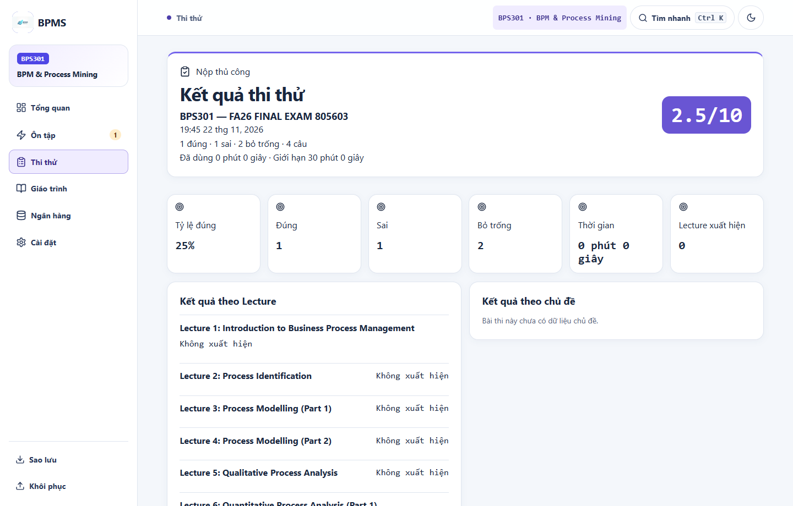

<div align="center">



<h1>BPMS</h1>

<strong>Business Process Management System</strong>

BPS301 Learning &amp; Exam Preparation Platform

Nền tảng học tập và luyện thi BPS301, tích hợp giáo trình, tài liệu PDF, ngân hàng câu hỏi, ôn tập thông minh, thi thử và phân tích kết quả.


[Workflow kiểm tra RC](.github/workflows/release-check.yml)

[Live Demo](https://minhnc9504.github.io/BPS301/) · [Cài đặt](#cài-đặt) · [Tính năng](#tính-năng) · [Tài liệu](#tài-liệu)

</div>

> **Release Candidate · 1.0.0-rc.1.** Bản trong repository đã qua kiểm tra staging cục bộ. Live Demo là phiên bản Pages đang phục vụ trước đợt RC này. Xem [báo cáo phát hành](PHASE7-RELEASE-REPORT.md).

## Mục lục

- [Tổng quan](#tổng-quan) · [Tính năng](#tính-năng) · [Dữ liệu đi kèm](#dữ-liệu-đi-kèm)
- [Ảnh giao diện](#ảnh-giao-diện) · [Công nghệ](#công-nghệ) · [Cài đặt](#cài-đặt)
- [Cấu trúc dự án](#cấu-trúc-dự-án) · [Sử dụng](#sử-dụng) · [Lưu trữ và quyền riêng tư](#lưu-trữ-và-quyền-riêng-tư)
- [Kiểm thử](#kiểm-thử) · [Phát hành](#phát-hành) · [Giới hạn](#giới-hạn)
- [Bản quyền](#bản-quyền) · [Lộ trình](#lộ-trình) · [Tài liệu](#tài-liệu)

## Tổng quan

BPMS dành cho người học BPS301 muốn đọc giáo trình Business Process Management & Process Mining, luyện câu hỏi theo từng phần và tự đánh giá trước kỳ thi. Giao diện dùng tiếng Việt, còn câu hỏi và tài liệu giữ nguyên ngôn ngữ nguồn.

*BPMS is a local-first learning and exam preparation app for the BPS301 Business Process Management and Process Mining course.*

## Tính năng

| Mô-đun | Chức năng |
| --- | --- |
| Tổng quan | Xem tiến độ theo chương, hoạt động gần đây và tiếp tục từ nội dung đang học. |
| Giáo trình | Đọc và tìm kiếm theo Lecture, đánh dấu đã học và mở phiên ôn từ những câu liên quan. |
| PDF Slide Viewer | Mở đúng trang nguồn, chuyển trang, thu phóng, đổi kiểu vừa khung và xem toàn màn hình. |
| Ôn tập | Lọc theo đề, chương, chủ đề hoặc trạng thái. Hỗ trợ câu một và nhiều đáp án, phản hồi, giải thích và mẹo nếu có. |
| Ôn lặp lại | Theo dõi câu đến hạn dựa trên lịch sử trả lời, đánh dấu khó hoặc chọn ôn lại sau. |
| Thi thử | Chọn đề, số câu, thời gian và thứ tự trộn. Lưu bài đang làm khi tải lại, hỗ trợ đánh dấu và tự nộp theo cấu hình. |
| Phân tích kết quả | Xem đúng, sai, bỏ trống và phân tích theo Lecture hoặc chủ đề khi có dữ liệu. So sánh lịch sử và mở phiên ôn từ bài đã nộp. |
| Ngân hàng câu hỏi | Tìm, nhập và xuất đề JSON, chỉnh sửa câu hỏi và quản lý liên kết slide. |
| Sao lưu và khôi phục | Xuất toàn bộ hoặc chỉ tiến độ, xem trước tệp và chọn gộp hoặc ghi đè theo phạm vi. |
| Cài đặt | Chỉnh giao diện sáng/tối, cỡ chữ, phím tắt, phản hồi và cấu hình thi mặc định. |

## Dữ liệu đi kèm

| Bộ đề | Câu hỏi | Lecture | Mục chính | Mục bổ sung | PDF | Trang PDF | Tham chiếu slide |
| ---: | ---: | ---: | ---: | ---: | ---: | ---: | ---: |
| 6 | 310 | 11 | 48 | 32 | 11 | 485 | 343 |

Số liệu lấy từ [danh mục môn](public/data/bps301/subject.json), [giáo trình](public/data/bps301/theory.json) và PDF đã đối chiếu bằng `npm run check:release`. Tên đề trong giao diện lấy từ JSON. Chẳng hạn, tệp `FA26.json` có tên hiển thị **FA25**.

## Ảnh giao diện

Ảnh chụp bản RC chạy cục bộ trên Chrome bằng hồ sơ kiểm thử riêng. Các lựa chọn và kết quả trong ảnh được tạo khi thao tác với bộ đề có sẵn.



<details>
<summary>Giáo trình và trình xem slide</summary>





</details>

<details>
<summary>Ôn tập và Ngân hàng câu hỏi</summary>





</details>

<details>
<summary>Thi thử và phân tích kết quả</summary>





</details>

## Công nghệ

- **React 19 · TypeScript 5 · Vite 7** cho giao diện, kiểu dữ liệu và bản build tĩnh.
- **CSS tùy chỉnh · Lucide** cho bố cục, giao diện sáng/tối và biểu tượng.
- **PDF.js** để hiển thị trang PDF với worker tải khi cần. **DOMPurify** lọc HTML trước khi hiển thị.
- **localStorage · IndexedDB · Web Locks** lưu dữ liệu và điều phối ghi giữa các tab cùng origin.

## Cài đặt

Yêu cầu Git, npm và **Node.js 22.13+**. CI dùng Node.js 24.

```bash
git clone https://github.com/minhnc9504/BPS301.git
cd BPS301
npm install
npm run dev
```

Mở địa chỉ Vite báo, thường là `http://localhost:5173/`. Dùng `npm ci` nếu cần cài đúng các phiên bản đã khóa.

```bash
npm run build
npm run preview
```

Bản tối ưu nằm trong `dist/`. Khi chạy preview, mở đường dẫn dưới `/BPS301/` tại địa chỉ Vite báo.

## Cấu trúc dự án

```text
src/
├── App.tsx                     # Điều phối giao diện và trạng thái
├── routes.ts                   # Định tuyến và đường dẫn trực tiếp
├── components/                 # Hiển thị câu hỏi, nội dung và tiến độ
├── features/                   # Các màn hình học, thi và quản lý
└── data/                       # Schema, lưu trữ, lịch ôn và phân tích
public/
├── data/bps301/                # Danh mục môn, lý thuyết, đề JSON
├── materials/bps301/           # PDF đóng gói
├── img/logo.jpg                # Logo và favicon
└── 404.html                    # Fallback deep link trên Pages
scripts/                        # Manifest, kiểm tra bản build, công cụ nội dung
tests/                          # Unit test và E2E
docs/                           # Hướng dẫn và ảnh giao diện
.github/workflows/              # CI, đăng đề và phát hành thủ công
```

## Sử dụng

1. Vào **Giáo trình**, chọn Lecture và mục cần đọc. Mở slide liên quan ngay tại mục đang học.
2. Chọn **Luyện tập ngay** hoặc vào **Ôn tập** để lọc theo đề, chương, chủ đề hoặc lịch đến hạn. Trả lời rồi xem phản hồi, lời giải và nguồn nếu có.
3. Vào **Thi thử**, chọn đề và cấu hình phiên. Nộp bài để mở báo cáo, sau đó chọn **Ôn lại câu sai** hoặc **Ôn câu sai và bỏ trống**.
4. Vào **Cài đặt & Dữ liệu** để tải bản sao lưu. Khi đổi máy hoặc địa chỉ truy cập, khôi phục JSON rồi gắn lại tệp tài liệu cá nhân nếu cần.

[Hướng dẫn sử dụng chi tiết](docs/USER_GUIDE.md)

## Lưu trữ và quyền riêng tư

BPMS dùng mô hình **local-first**. Tiến độ, lịch thi, đề tự thêm và trạng thái xác minh nằm trong localStorage. PDF và ảnh do người học nhập nằm trong IndexedDB. Web Locks tuần tự hóa lượt ghi giữa các tab cùng origin, còn sự kiện `storage` giúp cập nhật trạng thái trên các tab khác.

Mỗi tổ hợp giao thức, tên miền và cổng có kho riêng. Để chuyển máy hoặc origin, xuất JSON và giữ tài liệu nhập riêng. Trình duyệt thiếu Web Locks mở ứng dụng ở chế độ chỉ đọc. [Chi tiết dữ liệu và khôi phục](docs/DATA_AND_BACKUP.md)

## Kiểm thử

```bash
npm test
npm run build
npm run check:release
```

`check:release` chạy unit test, TypeScript, build và kiểm tra dữ liệu, manifest PDF, asset, deep link và kích thước gói. Workflow CI đã được cấu hình trong repository. Trạng thái badge trên GitHub sẽ có sau khi workflow được đưa lên và chạy. Có E2E bằng Playwright Core cho đồng bộ nhiều tab và nâng cấp cùng origin. Phase 7 xác nhận trên Chrome và Edge. Firefox và Safari còn trong phạm vi kiểm thử tiếp theo. [Hướng dẫn chạy E2E](docs/ARCHITECTURE.md#kiểm-thử)

## Phát hành

GitHub Pages dùng base `/BPS301/`. Workflow **Validate BPMS release candidate** kiểm tra build. Sau khi chủ dự án duyệt quyền công khai tài liệu và SHA, chạy **Publish approved BPMS build to GitHub Pages** từ `main`, nhập SHA và bật `materials_approved`. Khi cần rollback, đưa bản đã duyệt trở lại cùng URL và origin theo hướng dẫn phát hành. [Quy trình phát hành và rollback](docs/DEPLOYMENT.md)

## Giới hạn

- Đồng bộ hiện tại diễn ra giữa các tab cùng origin. Việc chuyển thiết bị dùng sao lưu và khôi phục thủ công.
- Kho dữ liệu phụ thuộc dung lượng và vòng đời hồ sơ trình duyệt. Bản sao JSON chứa metadata tài liệu, còn nội dung nhị phân IndexedDB cần tải riêng.
- Đề công khai có đáp án trong JSON. Thi thử che đáp án trên giao diện đến khi nộp bài.
- Phạm vi tương thích đã xác nhận và các giới hạn kiểm thử được ghi trong [báo cáo Phase 7](PHASE7-RELEASE-REPORT.md).

## Bản quyền

Chưa xác minh giấy phép phân phối **mã nguồn** cho repository này. **Bộ câu hỏi**, **PDF giáo trình** và **nội dung bên thứ ba** có thể chịu các quyền riêng. Quyền dùng để học và quyền đăng lại công khai cần được xác nhận riêng. PDF trong thư mục `public/` có thể tải trực tiếp nếu phát hành lên Pages công khai. Chủ dự án cần xác nhận quyền và rà nội dung nhạy cảm trước khi phê duyệt phát hành.

## Lộ trình

| Trạng thái | Phạm vi |
| --- | --- |
| Đã hoàn thành | Các luồng học, xem PDF, ôn, thi, sao lưu và hệ thống kiểm tra RC. |
| Đang xác nhận | Quyền công khai tài liệu và phê duyệt phát hành thử. |
| Tiếp theo | Mở rộng kiểm thử Firefox, Safari và đánh giá khả năng tiếp cận. |

## Tài liệu

- [Hướng dẫn sử dụng](docs/USER_GUIDE.md)
- [Kiến trúc và kiểm thử](docs/ARCHITECTURE.md)
- [Dữ liệu và sao lưu](docs/DATA_AND_BACKUP.md)
- [Phát hành và rollback](docs/DEPLOYMENT.md)
- [QA Phase 6](PHASE6-QA-REPORT.md) · [Release Candidate Phase 7](PHASE7-RELEASE-REPORT.md)
